# idrive7-EVAHUD

[中文](README.md) | **English**

An app that draws the windshield HUD and instrument cluster of BMW iDrive 7 (MGU) cars as a NERV operations screen from *Neon Genesis Evangelion*.

By DukeAPenguin. This is an unofficial personal project, not affiliated with BMW, khara or the upstream authors listed below. Modifying your head unit is at your own risk.

> **This repository contains no fonts**, no built `.mgu` and no BMW `oap-sdk`. You can't build it without the fonts; see [Fonts](#fonts). The NERV mark is included.

## Screenshots

### HUD

| Sport | Full-screen alert (menu preview) |
|:---:|:---:|
| 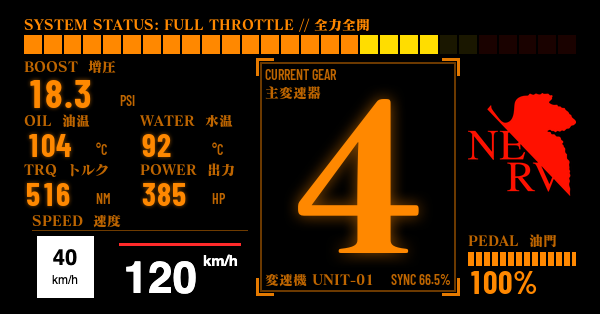 | 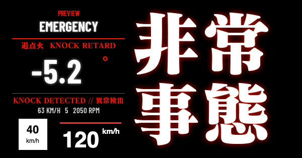 |
| **Comfort** | **Eco Pro** |
| 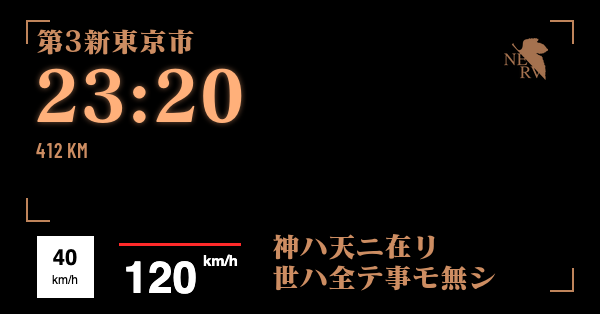 | 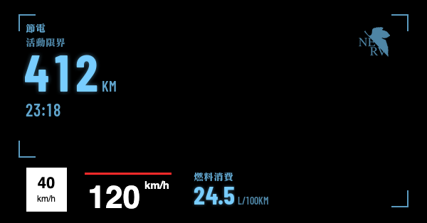 |
| **Comfort in P** | **Comfort in R** |
| 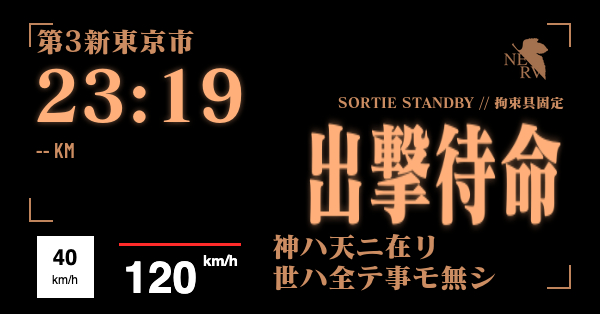 | 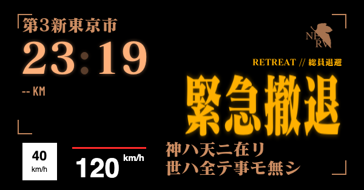 |

These are all simulator shots with demo data. Brightness and color on real glass will differ.

- The white speed limit sign and `120 km/h` at the lower left are the simulator's stand-in for BMW's own content. It can't be removed on the car, so the layout leaves room for it.
- The P and R shots use manual signals. The simulator has no range data in that case, so range reads `--`.

### Cluster

| A: Command room | B: Active limit |
|:---:|:---:|
| 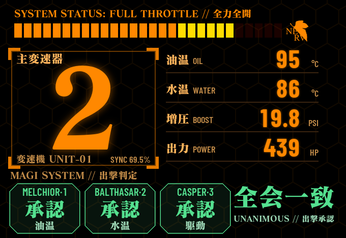 | 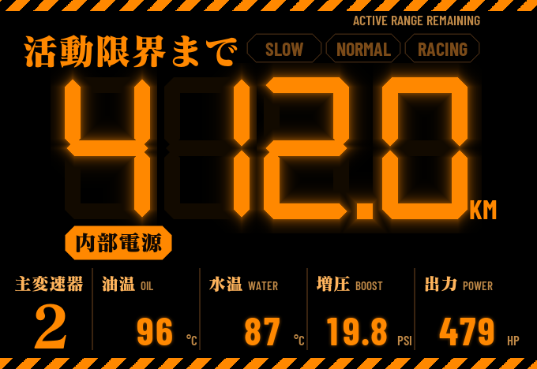 |
| **C1: Big clock** | **C2: Title card** |
| 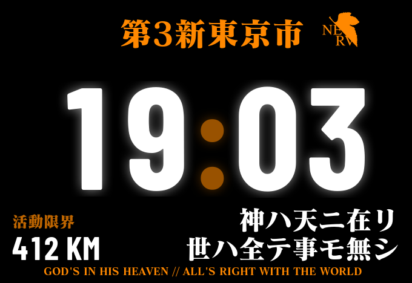 | 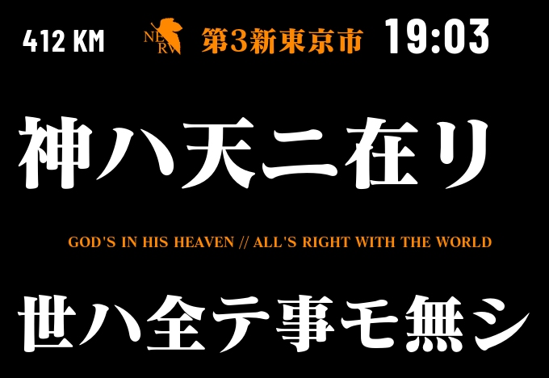 |
| **E1: Fuel use** | **E2: Hex rings** |
| 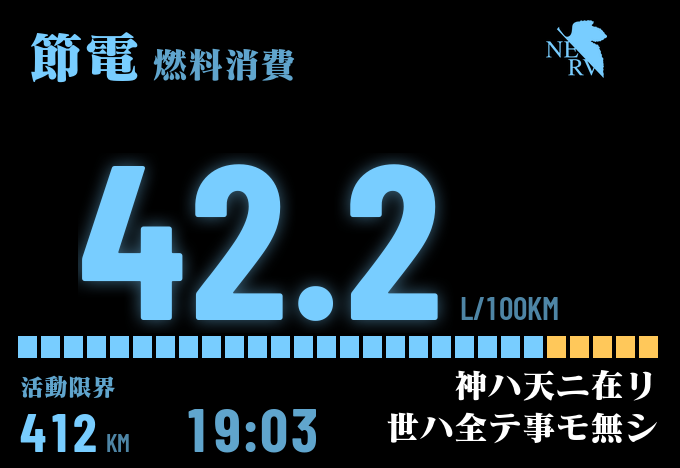 | 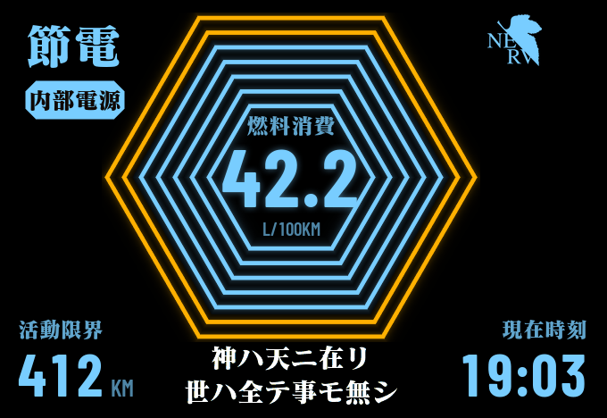 |
| **Original (whole cluster)** | **D: Battle stations (whole cluster)** |
| 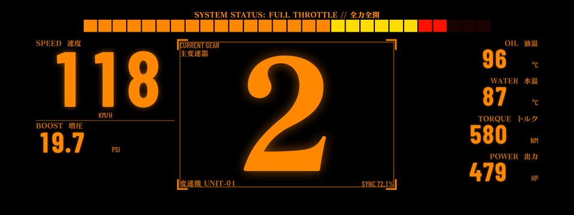 | 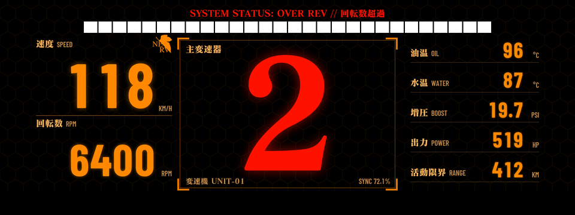 |
| **C3: Tokyo-3 (whole cluster)** | **E3: Active limit (whole cluster)** |
| 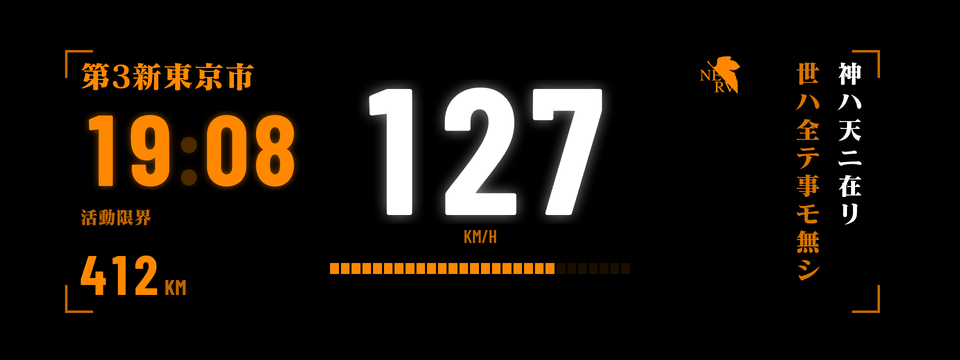 | 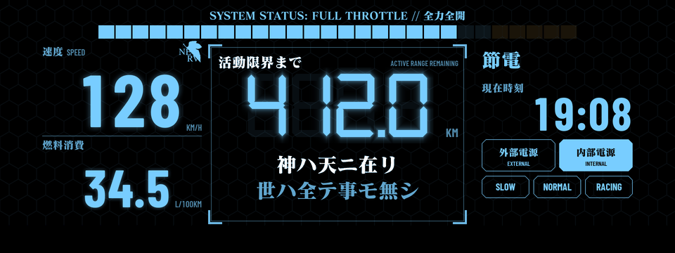 |
| **Full-screen alert: map-area designs (menu preview)** | **Full-screen alert: whole cluster (menu preview)** |
| 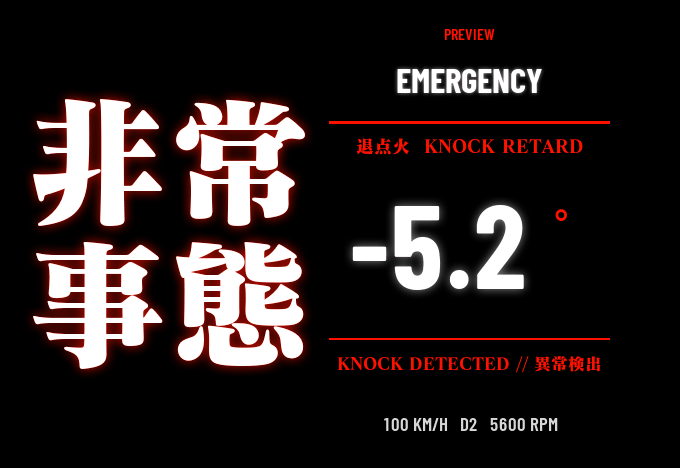 | 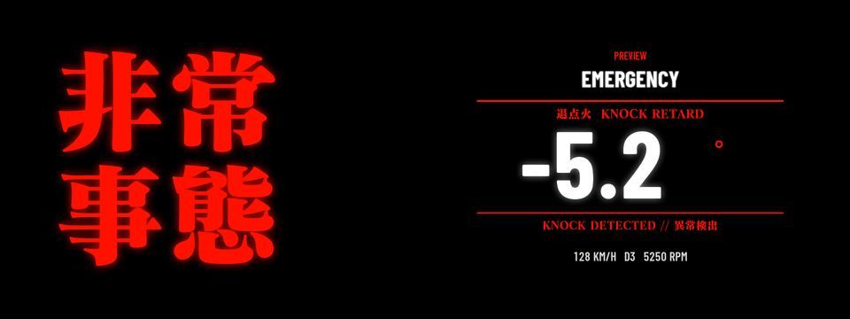 |

These are simulator shots with demo data too.

- A, B, C1, C2, E1 and E2 draw in the map area between BMW's two gauges. The shots leave out the edges BMW's gauges cover. On the car, BMW's digital speed and on-board computer area stay visible.
- The whole-cluster designs cover BMW's gauges, and those shots show the entire cluster screen.

## Features

- **One master switch, three modes:** HUD only, Dash only and HUD + Dash, picked in the center screen menu. Each mode has its own layouts and memory plan, and the menu shows only the rows the current mode uses.
- **A picture for each drive mode:** Comfort, Sport and Eco Pro each pick what the HUD and the dash show, or turn them off.
- **HUD only changes layout with the drive mode:**
  - Sport: battle style, with a huge gear and a rev bar.
  - Comfort: time, range and a line of melodramatic EVA-style text (one of six, picked in the menu).
  - Eco Pro: range, time and fuel use.
- **Nine new dash designs:** switch between them in the menu at any time, or give Comfort, Sport and Eco Pro one each. A, B, C1, C2, E1 and E2 draw only in the I-shaped area that stays clear between BMW's two gauges, so all of BMW's gauges stay. D, C3 and E3 cover the whole cluster. Sport is orange, Comfort orange and white, Eco Pro blue.
  - A: MAGI's sortie check, a huge gear and a column of readings.
  - B: range or time as seven-segment digits, with power and mode lamps.
- **Big gear words:** in Comfort and Eco Pro, P, R and N show `出撃待命` (sortie standby), `緊急撤退` (retreat) and `同期解除` (synchro cut). They disappear once you drive off.
- **Full-screen alerts:** knock, fuel pressure, air-fuel ratio, coolant temperature and boost.
- **Read only:** engine data is only read. Nothing is written to the car.
- **Makes way for BMW's content:** BMW's own HUD speed can't be removed, so the layout leaves room for it. The app gets out of the way when a BMW popup appears.

More in [apps/eva_hud/README.md](apps/eva_hud/README.md), the [design document](docs/superpowers/specs/2026-11-05-eva-hud-design.md) and the [performance study](docs/superpowers/2026-11-05-eva-hud-performance.md), all in Chinese.

**Current status:** 0.5.3 runs on the car. A, B, C1, C2, E1 and E2 go on `map`, under BMW's gauges, so BMW's on-board computer area works, and they're laid out around the dark shading measured on the car. Original, D, C3 and E3 go on `panel`, where the on-board computer area may not work, which isn't confirmed yet. With Central display area on Map view, cluster-render often loses the stock map's slot, a known upstream race. Upstream's docs suggest Off avoids it, but that hasn't been tried on a car yet. The layouts were fitted on one M440i, so other models may be off.

## Built on

The original EVA HUD concept and visual style come from the author's own phone project, [eva_hud_app](https://github.com/PenguinDukeYDAuto/eva_hud_app). This repository brings it to the car, using code from these projects:

| Upstream | Author | What this repository uses | Licence |
|---|---|---|---|
| [bimmer-lab/apps](https://github.com/bimmer-lab/apps) | bimmer-lab | Direct upstream. The HUD Widgets drawing engine in `shared/`, the `bench/` simulator, `tools/bake_fonts.py` and the repository layout | MIT |
| [cauliflowermossgrape/idrive7-apps](https://github.com/cauliflowermossgrape/idrive7-apps) | cauliflowermossgrape (Chinese translation: 小白151 / JackieZ123430) | The MGU App Kit in `kit/`; the engine control unit's diagnostic IDs and scaling in `app.json` (from car_vitals and Live Data); shift scoring and the rev bar (from Redline, by way of bimmer-lab/apps) | MIT |
| [robertnisipeanu/idrive-apps](https://github.com/robertnisipeanu/idrive-apps) | Robert Nisipeanu | `shared/cluster_render_client.js` (unmodified). At run time the app depends on its cluster-render service, which is installed separately and is **not in this repository** | Client MPL-2.0, service GPL-3.0 |

Also:

- The popup yielding in `shared/eva_popups.js` is the same idea as `hud_yield_slots`, which eroobeeroo contributed to cluster-render. eroobeeroo was also the first to verify the HUD's slot `0x323` on a real car.
- The NERV mark is from *Neon Genesis Evangelion* (khara).

### Baseline versions

| Upstream | Version |
|---|---|
| bimmer-lab/apps | `44a50c5`. Upstream has added 4 theme commits since then, which are not merged |
| MGU App Kit | Came with bimmer-lab/apps `44a50c5` |
| cluster-render | `cluster-render@0.3.10` (`bbcbe42`). The car now runs `0.4.0`, which displays correctly, but popup yielding isn't verified on it yet |

This repository started from a fresh commit, **without upstream's git history**, because that history holds font files.

### Differences from upstream

Added:

- `apps/eva_hud/`
- `shared/eva_*.js`
- `tools/eva_layout.py` and `tools/assets/`
- `bench/test/`
- `docs/superpowers/`
- `docs/screenshots/`

Changed:

- `shared/hud.js`, `hud_themes.js`, `layouts.js`, `shaders.js`
- The `bench/` simulator
- `tools/bake_fonts.py`
- `kit/tools/build.py`: `credits` in `app.json` can set the credit on the menu's last line
- `scripts/deploy.sh`, `docs/DEVELOPING.md`: point to `eva_hud` by default

Removed:

- Upstream's `apps/cluster_themes` and `apps/idrive_hud_widgets`
- `docs/images/` and `mgu-repo.json`
- All fonts

## Fonts

This repository has no font files and no baked glyphs. `.gitignore` blocks those paths and the font file extensions.

Get these yourself before building:

| Font | Where it goes | Source | Licence |
|---|---|---|---|
| MatissePro EB (`MatissePro-EB.otf`) | Anywhere; point the `MATISSE` environment variable at it | A commercial typeface; you need your own licence | Commercial |
| Barlow Condensed Bold and SemiBold (`BarlowCondensed-Bold.ttf`, `BarlowCondensed-SemiBold.ttf`) | `tools/fonts-src/` | [Barlow](https://github.com/jpt/barlow) | SIL OFL 1.1 |

Then bake the glyphs, which generates `apps/eva_hud/hud/fonts/`:

```sh
MATISSE=/path/to/MatissePro-EB.otf uv run --no-project --with pillow python tools/eva_layout.py
```

**A built `.mgu` holds MatissePro glyphs. Don't publish it to Releases or anywhere else public.**

## Build and test

You need Node, Python 3 and the fonts from the previous step.

```sh
node bench/server.js eva_hud        # the simulator, on a Mac; open http://localhost:8078
```

The simulator's first run generates a fake `oap-sdk/`, which can't be installed on a car. The tests need that folder too, so run the simulator once, then:

```sh
for t in flicker layout popups alerts canvas diag magi demo dash; do node bench/test/eva_${t}_test.js | tail -1; done
```

Installing on a car needs the real `oap-sdk` extracted from a BMW app. It can't be redistributed, so it isn't here. The steps are in [apps/eva_hud/README.md](apps/eva_hud/README.md#装上车) (in Chinese). **Updating the app runtime restarts the head unit, so don't install while driving.**

## Licence

The code in this repository is under the [MIT licence](LICENSE), except:

| Part | Licence |
|---|---|
| `kit/` | MIT, copyright its original authors; see [kit/LICENSE](kit/LICENSE) |
| `shared/cluster_render_client.js` | MPL-2.0, copyright Robert Nisipeanu |
| The NERV mark in `apps/eva_hud/hud/logos/`, `tools/assets/nerv_mask.png`, `apps/eva_hud/icon.png` and `docs/screenshots/` | Not covered by the MIT licence; the rights belong to their owners |
| The letterforms shown in `docs/screenshots/` (MatissePro, Barlow) | Not covered by the MIT licence; the rights belong to each font's owners. The screenshots are only images and hold no font files |

Third-party notices are in [apps/eva_hud/NOTICE](apps/eva_hud/NOTICE).
