# idrive7-EVAHUD

**中文** | [English](README.en.md)

把 BMW iDrive 7（MGU）的挡风玻璃 HUD 和仪表盘画成《新世纪福音战士》NERV 作战界面的 app。

作者：DukeAPenguin。这是非官方的个人项目，和 BMW、khara 以及下面列出的上游作者都没有关系。改装车机的风险由你自己承担。

> **本仓库不包含任何字体**，也不包含构建好的 `.mgu` 和 BMW 的 `oap-sdk`。没有字体就无法构建，做法见[字体](#字体)。NERV 标志包含在仓库里。

## 截图

### HUD

| Sport | 全屏警报（菜单预览） |
|:---:|:---:|
| 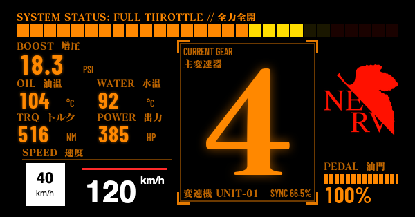 | 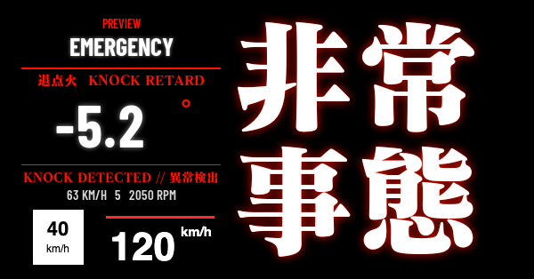 |
| **Comfort** | **Eco Pro** |
| 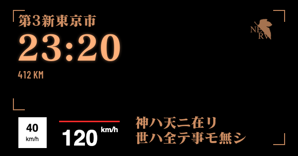 | 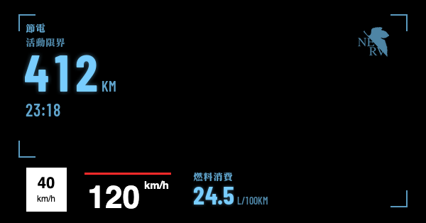 |
| **Comfort 挂 P** | **Comfort 挂 R** |
| 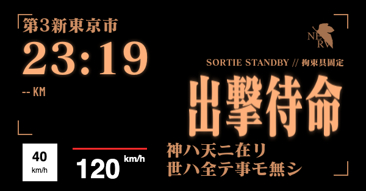 |  |

以上都是模拟器截图，数值是演示数据，真实玻璃上的亮度和颜色会不同。

- 左下角的白色限速牌和 `120 km/h` 是模拟器画的 BMW 原厂内容，实车上去不掉，版面给它留了位置。
- 挂 P 和 R 的两张用手动信号拍摄。模拟器在这种情况下没有续航数据，所以显示 `--`。

### 仪表

| A：Command room | B：Active limit |
|:---:|:---:|
| 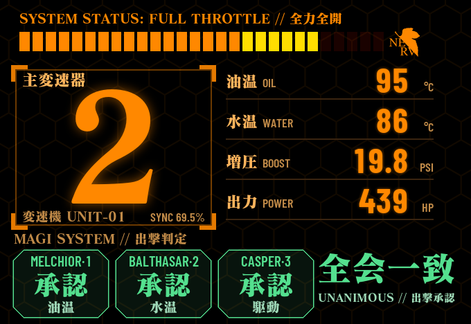 | 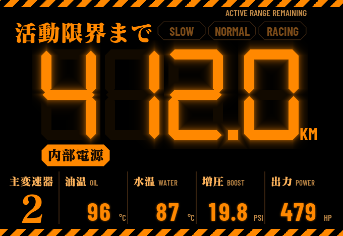 |
| **C1：Big clock** | **C2：Title card** |
|  | 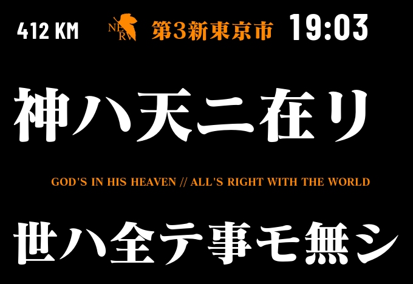 |
| **E1：Fuel use** | **E2：Hex rings** |
| 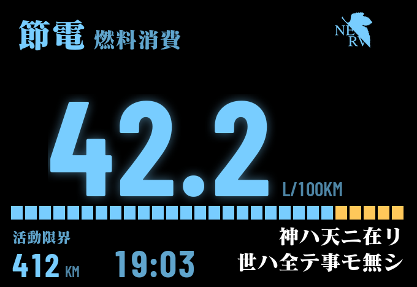 | 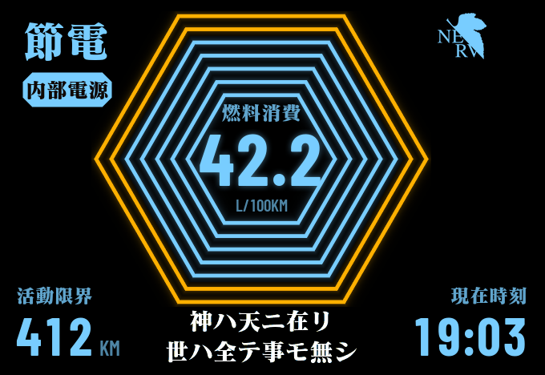 |
| **Original（整块仪表）** | **D：Battle stations（整块仪表）** |
| 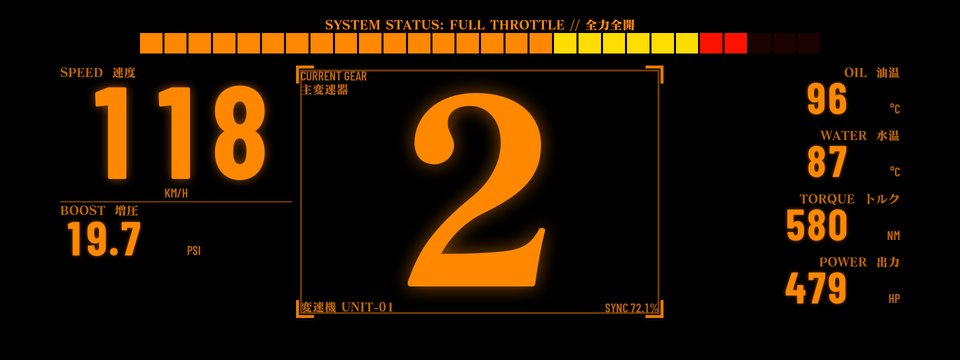 | 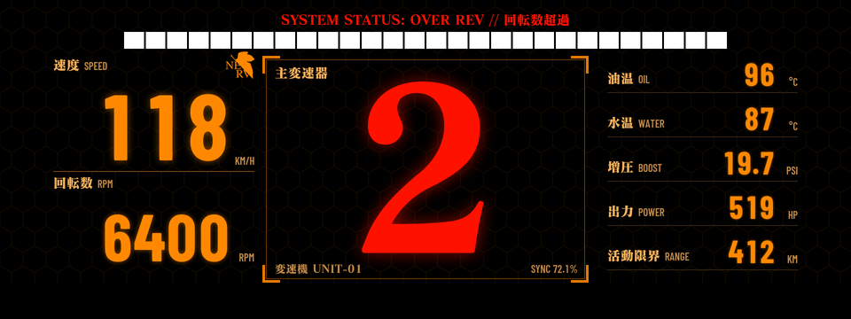 |
| **C3：Tokyo-3（整块仪表）** | **E3：Active limit（整块仪表）** |
| 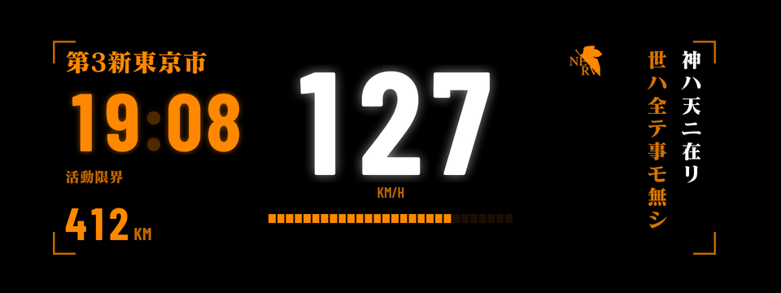 | 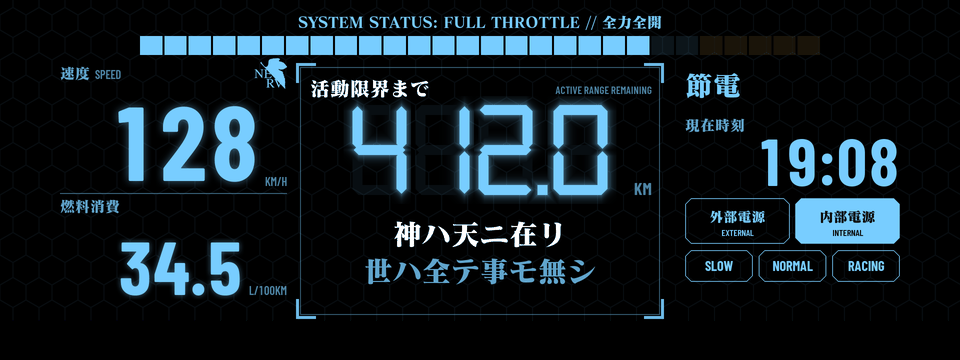 |
| **全屏警报：地图区设计（菜单预览）** | **全屏警报：整块仪表（菜单预览）** |
| 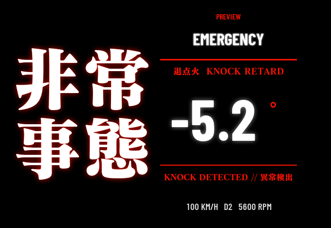 | 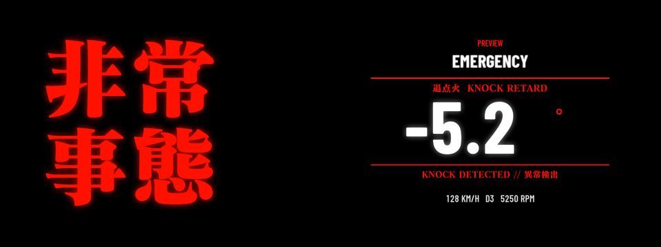 |

这些也是模拟器截图和演示数据。

- A、B、C1、C2、E1、E2 画在 BMW 两个表盘中间的地图区。截图裁掉了四周被 BMW 表盘挡住的部分，实车上 BMW 的数字车速和 BC 区还在。
- 整块仪表的设计盖住 BMW 的表盘，截图是整个仪表屏幕。

## 功能

- **一个总开关，三种模式：** HUD only、Dash only、HUD + Dash，在中控屏菜单里选。每种模式有自己的布局和内存方案，菜单只显示当前模式用得到的选项。
- **每个驾驶模式各选各的画面：** Comfort、Sport、Eco Pro 分别选 HUD 和仪表显示什么，也可以关闭。
- **HUD only 跟随驾驶模式换版面：**
  - Sport：战斗风格，巨大挡位和转速条。
  - Comfort：时间、续航和一句中二文字（菜单里六选一）。
  - Eco Pro：续航、时间和油耗。
- **仪表有九种新设计可选：** 菜单里随时切换，也可以让 Comfort、Sport、Eco Pro 各用各的。A、B、C1、C2、E1、E2 只画在 BMW 两个表盘中间清楚可见的工字形区域，BMW 的表都留着；D、C3、E3 盖住整块仪表。Sport 用橙色，Comfort 用橙加白，Eco Pro 用蓝色。
  - A：MAGI 出撃判定、巨大挡位和一列读数。
  - B：七段数字显示续航或时间，加电源灯和模式灯。
- **挡位大字：** Comfort 和 Eco Pro 挂进 P、R、N 时显示 `出撃待命`、`緊急撤退`、`同期解除`，开起来就消失。
- **全屏警报：** 爆震、燃油压力、空燃比、水温、增压。
- **只读：** 发动机数据只读取，不向车辆写入。
- **避让 BMW 内容：** BMW 自己的 HUD 车速去不掉，版面给它留了位置；BMW 弹窗出现时自动让路。

更多内容见 [apps/eva_hud/README.md](apps/eva_hud/README.md)、[设计文档](docs/superpowers/specs/2026-11-05-eva-hud-design.md) 和[性能研究](docs/superpowers/2026-11-05-eva-hud-performance.md)。

**当前状态：** 0.5.3 已经在车上运行。A、B、C1、C2、E1、E2 投 `map`（BMW 表盘下面），BC 区可以正常用，版面按实车量到的黑化范围排过。Original、D、C3、E3 投 `panel`，这时 BC 区可能不能用，还没确认。Central display area 选 Map view 时，cluster-render 经常抢不到原厂地图的位置（上游已知的竞态）。按上游文档设成 Off 应该能避开，但还没在车上试过。版面是按一台 M440i 调的，其他车型可能有偏差。

## 开发自哪些项目

EVA HUD 的原始概念和视觉风格来自作者自己的手机项目 [eva_hud_app](https://github.com/PenguinDukeYDAuto/eva_hud_app)。这个仓库把它搬到车上，代码开发自下面这些项目：

| 上游项目 | 作者 | 本仓库用到的部分 | 许可证 |
|---|---|---|---|
| [bimmer-lab/apps](https://github.com/bimmer-lab/apps) | bimmer-lab | 直接上游。`shared/` 的 HUD Widgets 绘制引擎、`bench/` 模拟器、`tools/bake_fonts.py`、仓库结构 | MIT |
| [cauliflowermossgrape/idrive7-apps](https://github.com/cauliflowermossgrape/idrive7-apps) | cauliflowermossgrape（中文翻译：小白151 / JackieZ123430） | `kit/` 的 MGU App Kit；`app.json` 里发动机控制单元的诊断 ID 和换算（来自 car_vitals 和 Live Data）；换挡评分和转速条（来自 Redline，经 bimmer-lab/apps 移植） | MIT |
| [robertnisipeanu/idrive-apps](https://github.com/robertnisipeanu/idrive-apps) | Robert Nisipeanu | `shared/cluster_render_client.js`（未修改）；运行时依赖它的 cluster-render 服务，需要单独安装，**不在本仓库** | 客户端 MPL-2.0，服务 GPL-3.0 |

另外：

- `shared/eva_popups.js` 的弹窗让路做法，和 cluster-render 里 eroobeeroo 贡献的 `hud_yield_slots` 是同一思路。HUD 使用的 slot `0x323` 也是 eroobeeroo 先在实车上验证的。
- NERV 标志出自《新世纪福音战士》（khara）。

### 基准版本

| 上游 | 版本 |
|---|---|
| bimmer-lab/apps | `44a50c5`。上游之后又加了 4 个主题提交，没有合并 |
| MGU App Kit | 随 bimmer-lab/apps `44a50c5` 带来 |
| cluster-render | `cluster-render@0.3.10`（`bbcbe42`）。车上现在用 `0.4.0`，显示正常，弹窗让路还没验证 |

这个仓库是一次全新的提交，**没有带上游的 git 历史**，因为上游历史里有字体文件。

### 和上游的差别

新增：

- `apps/eva_hud/`
- `shared/eva_*.js`
- `tools/eva_layout.py` 和 `tools/assets/`
- `bench/test/`
- `docs/superpowers/`
- `docs/screenshots/`

修改：

- `shared/hud.js`、`hud_themes.js`、`layouts.js`、`shaders.js`
- `bench/` 的模拟器
- `tools/bake_fonts.py`
- `kit/tools/build.py`：`app.json` 可以用 `credits` 指定菜单最后一行的署名
- `scripts/deploy.sh`、`docs/DEVELOPING.md`：默认指向 `eva_hud`

删除：

- 上游的 `apps/cluster_themes`、`apps/idrive_hud_widgets`
- `docs/images/`、`mgu-repo.json`
- 所有字体

## 字体

仓库里没有字体文件，也没有烘焙好的字形。`.gitignore` 会挡住这些路径和字体扩展名。

构建前需要自己准备：

| 字体 | 放在哪里 | 来源 | 许可 |
|---|---|---|---|
| MatissePro EB（`MatissePro-EB.otf`） | 任意位置，用环境变量 `MATISSE` 指定 | 商业字体，需要自己取得授权 | 商业授权 |
| Barlow Condensed Bold 和 SemiBold（`BarlowCondensed-Bold.ttf`、`BarlowCondensed-SemiBold.ttf`） | `tools/fonts-src/` | [Barlow](https://github.com/jpt/barlow) | SIL OFL 1.1 |

然后烘焙字形，生成 `apps/eva_hud/hud/fonts/`：

```sh
MATISSE=/path/to/MatissePro-EB.otf uv run --no-project --with pillow python tools/eva_layout.py
```

**构建产物 `.mgu` 里含有 MatissePro 字形，不要发布到 Releases 或其他公开位置。**

## 构建和测试

需要 Node、Python 3，以及上一步生成的字体。

```sh
node bench/server.js eva_hud        # Mac 上的模拟器，打开 http://localhost:8078
```

模拟器第一次运行时会生成一个假的 `oap-sdk/`，它不能装车。测试也需要这个文件夹，所以先运行一次模拟器，然后：

```sh
for t in flicker layout popups alerts canvas diag magi demo dash; do node bench/test/eva_${t}_test.js | tail -1; done
```

装车要用从 BMW app 提取的真实 `oap-sdk`，它不能再分发，所以不在这里。步骤见 [apps/eva_hud/README.md](apps/eva_hud/README.md#装上车)。**应用运行时更新会带动车机重启，开车时不要装。**

## 许可证

本仓库的代码使用 [MIT](LICENSE)，以下部分除外：

| 部分 | 许可 |
|---|---|
| `kit/` | MIT，版权归原作者，见 [kit/LICENSE](kit/LICENSE) |
| `shared/cluster_render_client.js` | MPL-2.0，版权归 Robert Nisipeanu |
| `apps/eva_hud/hud/logos/`、`tools/assets/nerv_mask.png`、`apps/eva_hud/icon.png`、`docs/screenshots/` 里的 NERV 标志 | 不在 MIT 授权范围内，相关权利归权利人所有 |
| `docs/screenshots/` 里显示的文字字形（MatissePro、Barlow） | 不在 MIT 授权范围内，权利归各字体的权利人所有。截图只是图片，不含字体文件 |

第三方说明见 [apps/eva_hud/NOTICE](apps/eva_hud/NOTICE)。
